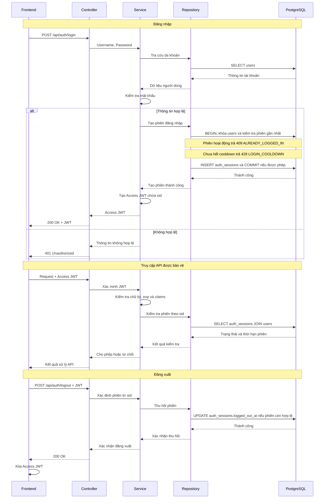

# Tài liệu kiến trúc

## 1. Giới thiệu và phạm vi kiến trúc

Phase 1 tập trung hoàn thiện các chức năng theo SRS, bảo đảm tính đúng đắn nghiệp vụ, tính nhất quán dữ liệu và bảo mật cơ bản. Tối ưu hiệu năng, mở rộng hệ thống và xử lý đồng thời chuyên sâu thuộc phạm vi Phase 2.

## 2. Cấu trúc repository

Mỗi thành phần (backend, frontend, cơ sở dữ liệu, triển khai, tài liệu) nằm trong thư mục riêng. Cây thư mục đầy đủ ở [README.md](README.md).

### 2.1. Quy ước tổ chức code backend

- Mỗi tài nguyên có một file trong mỗi tầng. Ví dụ `class.go` có ở `controller/`, `service/` và `repository/`. Không tách thêm `dto/` hay `model/`.
- Phụ thuộc chỉ đi một chiều: `controller → service → repository`. Controller không chứa SQL, service không import `gin`.
- Struct request và response nằm trong `controller/`. Struct theo bảng nằm trong `repository/` và được service dùng chung.
- Lỗi nghiệp vụ là biến khai báo trong `service/errors.go`, ví dụ `ErrClassFull`. Controller ánh xạ sang HTTP status và mã lỗi (`data.code`) theo `docs/api-design.md`.
- JWT và băm mật khẩu nằm trong `service/auth.go`. Middleware trong `controller/middleware.go` gọi service để xác minh token và kiểm tra phiên.
- Repository trả `nil` khi không tìm thấy bản ghi. Khi vi phạm UNIQUE, repository trả `ErrDuplicate` để service chuyển thành lỗi nghiệp vụ.
- Route nằm trong `controller/router.go`, gắn middleware theo nhóm endpoint.
- Tài liệu Swagger viết bằng chú thích ngay trên hàm handler trong `controller/`, sinh ra `backend/docs/`.

## 3. Luồng xử lý chính

### 3.1. Xác thực người dùng

Quy tắc phiên, TTL và cooldown nằm ở SRS §3.1; payload và mã lỗi ở `docs/api-design.md`. Frontend giữ JWT trong `sessionStorage` (bộ nhớ nếu storage không dùng được). Backend dùng cùng một đồng hồ ứng dụng khi tạo, kiểm tra và logout phiên, để khớp với `iat` và `exp` của JWT.

### 3.2. Đăng ký và hủy học phần

Luồng `POST /api/registrations` có ở [sơ đồ tuần tự](docs/diagrams/sequence/README.md). Service kiểm tra thời gian đăng ký, sĩ số, đăng ký trùng, trùng lịch, điều kiện tiên quyết và giới hạn tín chỉ; câu lệnh cập nhật sĩ số nằm trong ADR-02.

Một yêu cầu có thể chứa nhiều lớp (`class_ids`). Service lặp qua danh sách theo thứ tự gửi và xử lý mỗi lớp trong một transaction riêng. Lớp bị từ chối chỉ rollback transaction của chính nó, các lớp đã commit trước đó được giữ lại. Controller gộp kết quả từng lớp vào một response `200`.

Hủy đăng ký kiểm tra quyền sở hữu và điều kiện hủy, rồi xóa vật lý bản ghi `registrations` và giảm `course_classes.enrolled` trong cùng transaction, khóa dòng sinh viên rồi dòng lớp trước khi xóa. Đăng ký lại dùng `INSERT` và tạo ID mới. Admin hủy lớp khóa dòng lớp, xóa toàn bộ đăng ký của lớp, chuyển lớp sang `cancelled` và đặt sĩ số về 0 trong cùng transaction.

## 4. Kiến trúc dữ liệu

PostgreSQL gồm 9 bảng; cấu trúc và quan hệ nằm trong `docs/database-design.md`. Chỉ Repository chạy SQL, Service gọi Repository. Đăng ký và hủy học phần cập nhật bản ghi đăng ký và sĩ số lớp trong cùng một transaction.

## 5. Xác thực và phân quyền

Xác thực dùng JWT HS256 gắn với phiên lưu trong database ([ADR-03](docs/adr/03-jwt-authentication.md), [ADR-04](docs/adr/04-database-backed-auth-sessions.md)). Quyền được kiểm tra theo vai trò sinh viên hoặc quản trị viên và theo phạm vi dữ liệu được phép thao tác.

Mật khẩu được băm trước khi lưu; JWT secret và thời hạn token lấy từ biến môi trường. Token gửi qua header `Authorization`, không dùng cookie, nên Phase 1 không cần cơ chế chống CSRF riêng.

## 6. Kiến trúc triển khai và cấu hình

Docker Compose chạy frontend (nginx), backend (Go/Gin) và PostgreSQL trong các container riêng. Trên Render, backend phục vụ luôn frontend đã build (xem `deployment/README.md`). Backend đọc kết nối PostgreSQL, JWT secret, TTL và cổng từ biến môi trường. PostgreSQL dùng Docker volume nên phiên đăng nhập còn nguyên sau khi khởi động lại. Môi trường phát triển dùng HTTP, triển khai thực tế phải dùng HTTPS.
