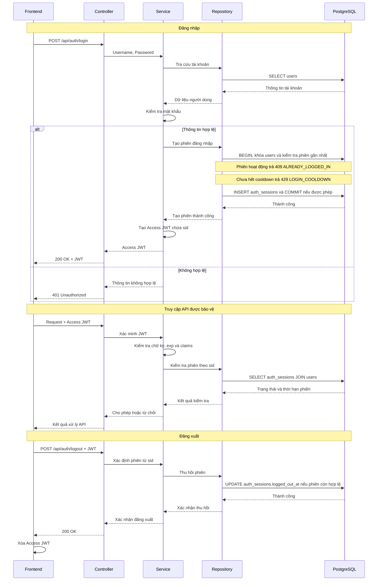
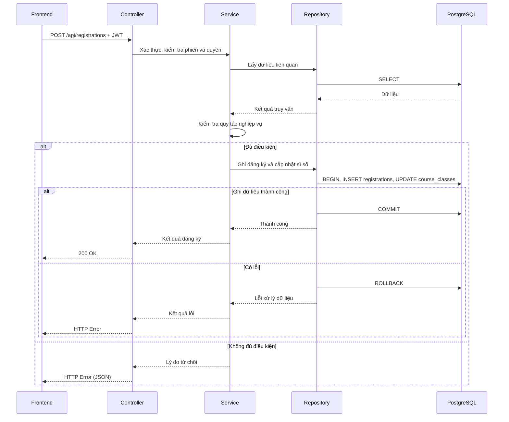

# Tài liệu kiến trúc

## 1. Giới thiệu và phạm vi kiến trúc

Phase 1 tập trung hoàn thiện các chức năng theo SRS, bảo đảm tính đúng đắn nghiệp vụ, tính nhất quán dữ liệu và bảo mật cơ bản. Tối ưu hiệu năng, mở rộng hệ thống và xử lý đồng thời chuyên sâu thuộc phạm vi Phase 2.

## 2. Cấu trúc repository

Mỗi thành phần (backend, frontend, cơ sở dữ liệu, triển khai, tài liệu) nằm trong thư mục riêng.

```text
course-registration/
├── backend/
│   ├── cmd/
│   │   └── api/
│   │       └── main.go          # nạp config, tạo DB pool, lắp ghép các tầng, chạy server
│   ├── internal/
│   │   ├── config/              # đọc biến môi trường vào struct Config
│   │   ├── controller/          # HTTP: route, middleware xác thực/phân quyền, handler, DTO, ánh xạ lỗi
│   │   ├── service/             # quy tắc nghiệp vụ, JWT, băm mật khẩu, lỗi nghiệp vụ
│   │   └── repository/          # truy vấn PostgreSQL, tạo connection pool
│   ├── docs/                    # Swagger sinh bởi swag, không sửa tay
│   ├── Dockerfile
│   ├── go.mod
│   └── go.sum
├── frontend/
│   ├── src/
│   │   ├── api/                 # client.ts (fetch, gắn token, xử lý 401), index.ts (hàm gọi từng endpoint), types.ts
│   │   ├── auth/                # AuthProvider (phiên, hẹn giờ hết hạn), sessionLock (chế độ chỉ xem sau khi gửi đăng ký)
│   │   ├── components/          # Layout, ui, PeriodBanner, ClassDetailModal, RegistrationFlow, Schedule
│   │   ├── hooks/               # useRequest
│   │   ├── pages/               # auth, student, schedule, admin
│   │   ├── App.tsx              # bảng route theo vai trò
│   │   ├── router.tsx           # router theo hash (#/...)
│   │   └── main.tsx
│   ├── nginx.conf               # phục vụ bản build và proxy /api/ trong Compose
│   ├── Dockerfile
│   └── package.json             # npm + package-lock.json
├── database/
│   ├── migrations/
│   └── tools/
├── deployment/                  # Dockerfile, start.py, smoke test cho Render
├── docs/
│   ├── SRS.md
│   ├── api-design.md
│   ├── database-design.md
│   ├── diagrams/
│   │   ├── deployment/
│   │   ├── erd/
│   │   ├── sequence/
│   │   ├── system-architecture/
│   │   └── use-case/
│   └── adr/
├── docker-compose.yml
├── render.yaml
├── ARCHITECTURE.md
├── .gitignore
└── README.md
```

### 2.1. Quy ước tổ chức code backend

- **Một file cho mỗi tài nguyên trong mỗi tầng.** Ví dụ `class.go` xuất hiện trong `controller/`, `service/` và `repository/`. Không tách thêm `dto/` hay `model/`.
- **Phụ thuộc chỉ đi một chiều:** `controller → service → repository`. Controller không chứa SQL. Service không import `gin`.
- **Struct request và response** nằm trong `controller/`. **Struct theo bảng** nằm trong `repository/` và được service dùng chung.
- **Lỗi nghiệp vụ** là biến khai báo trong `service/errors.go`, ví dụ `ErrClassFull`. Controller ánh xạ sang HTTP status và mã lỗi (`data.code`) theo `docs/api-design.md`.
- **JWT và băm mật khẩu** nằm trong `service/auth.go`. Middleware trong `controller/middleware.go` gọi service để xác minh token và kiểm tra phiên.
- **Repository trả `nil` khi không tìm thấy bản ghi.** Khi vi phạm ràng buộc UNIQUE, repository trả `ErrDuplicate` để service chuyển thành lỗi nghiệp vụ.
- **Route nằm trong `controller/router.go`**, gắn middleware theo nhóm endpoint.
- **Tài liệu Swagger** viết bằng chú thích ngay trên hàm handler trong `controller/`. Không duplicate nội dung API ở markdown.

## 3. Luồng xử lý chính

### 3.1. Xác thực người dùng



Access JWT HS256 chứa `sub`, `role`, `sid`, `iat`, `exp`. Frontend giữ JWT trong `sessionStorage` (bộ nhớ khi storage không khả dụng) và gửi trong header `Authorization: Bearer <token>`.

Backend kiểm tra chữ ký, thuật toán, claim JWT và phiên tương ứng với `sid`: `sub` khớp người sở hữu, `role` khớp vai trò hiện tại, `iat`/`exp` khớp thời điểm tạo/hết hạn ở độ chính xác giây. Phiên hoạt động khi `logged_out_at IS NULL` và chưa đến `expires_at`. Backend dùng cùng đồng hồ ứng dụng khi tạo, kiểm tra và logout phiên để thống nhất với JWT.

Mỗi sinh viên chỉ có một phiên hoạt động trên mọi thiết bị/tab; quản trị viên có thể có nhiều phiên. Kiểm tra mật khẩu trước, rồi khóa dòng `users`, kiểm tra phiên gần nhất (chỉ với sinh viên) và tạo phiên trong cùng transaction. Login khi phiên còn hoạt động trả `409 ALREADY_LOGGED_IN`, giữ nguyên phiên. Logout chỉ ghi `logged_out_at` một lần trước hạn; tự hết hạn không cập nhật bản ghi. Cooldown của sinh viên tính từ `COALESCE(logged_out_at, expires_at)` của phiên gần nhất cộng `LOGIN_COOLDOWN`. `expires_at = created_at + JWT_TTL` (`ADMIN_JWT_TTL` với quản trị viên); đổi TTL chỉ ảnh hưởng phiên mới.

Khi JWT hết hạn, người dùng đăng nhập lại.

### 3.2. Đăng ký và hủy học phần



Service kiểm tra thời gian đăng ký, sĩ số, đăng ký trùng, trùng lịch, điều kiện tiên quyết và giới hạn tín chỉ. Câu lệnh cập nhật sĩ số được mô tả trong ADR-02.

Một yêu cầu `POST /api/registrations` có thể chứa nhiều lớp (`class_ids`). Sơ đồ trên mô tả xử lý của **một lớp**: Service lặp qua danh sách theo thứ tự gửi và chạy luồng này cho từng lớp trong một transaction riêng. Lớp bị từ chối chỉ rollback transaction của chính nó, các lớp đã commit trước đó được giữ lại. Controller gộp kết quả từng lớp vào một response `200`.

Hủy đăng ký kiểm tra quyền sở hữu và điều kiện hủy, sau đó xóa vật lý bản ghi `registrations` và giảm `course_classes.enrolled` trong cùng transaction, khóa dòng sinh viên rồi dòng lớp trước khi xóa. Nếu có lỗi xảy ra, các thay đổi sẽ không được ghi nhận. Đăng ký lại dùng `INSERT`, tạo ID mới. Admin hủy lớp khóa dòng lớp, xóa toàn bộ đăng ký của lớp, chuyển lớp sang `cancelled` và đặt sĩ số về 0 trong cùng transaction.

### 3.3. Tra cứu và quản trị

- **Tra cứu:** Controller tiếp nhận yêu cầu, Service xử lý điều kiện tra cứu, Repository truy vấn dữ liệu và trả kết quả về Frontend.
- **Thông tin tài khoản:** `GET /api/auth/me` chỉ trả thông tin người dùng hiện tại, gồm khoa/ngành để frontend hiển thị tổng quan và lọc lớp.
- **Quản trị lớp học phần:** Kiểm tra quyền quản trị, dữ liệu đầu vào và các ràng buộc trước khi tạo, cập nhật hoặc hủy lớp.

## 4. Kiến trúc dữ liệu

- **Tổng quan dữ liệu:** PostgreSQL gồm 9 bảng; cấu trúc và quan hệ nằm trong `database-design.md`.
- **Truy cập dữ liệu:** Chỉ Repository chạy SQL; Service gọi Repository.
- **Giao dịch:** Đăng ký và hủy học phần cập nhật bản ghi đăng ký và sĩ số trong cùng một transaction.
- **Dữ liệu xác thực:** Bảng `auth_sessions` chỉ có `id`, `user_id`, `created_at`, `expires_at`, `logged_out_at`, kèm index (`user_id`, `created_at`).

## 5. Xác thực và phân quyền

- **Access Token:** JWT HS256 chứa định danh người dùng (`sub`), vai trò (`role`), mã phiên (`sid`), thời điểm phát hành (`iat`) và hết hạn (`exp`).
- **Phiên đăng nhập:** Mỗi lần đăng nhập được phép tạo một bản ghi trong `auth_sessions`. Sinh viên chỉ có một phiên hoạt động, quản trị viên có thể có nhiều; `sid` trỏ tới bản ghi này.
- **Kiểm tra token:** Backend xác minh chữ ký, thuật toán, claim và phiên (chưa logout, chưa hết hạn); đối chiếu người sở hữu, thời điểm tạo/hết hạn và vai trò hiện tại trước khi cho phép truy cập.
- **Phân quyền:** Quyền truy cập được kiểm tra theo vai trò Sinh viên/Quản trị viên và phạm vi dữ liệu được phép thao tác.
- **Đăng xuất:** Backend ghi `logged_out_at` một lần cho phiên hiện tại còn hạn. JWT mất hiệu lực ngay, frontend xóa JWT đang lưu. Phiên tự hết hạn giữ `logged_out_at = NULL`; với sinh viên, cả hai trường hợp bắt đầu cooldown từ thời điểm kết thúc tương ứng.
- **Bảo mật:** Mật khẩu được băm trước khi lưu trữ. JWT secret và thời hạn token được quản lý qua biến môi trường. Token gửi qua header `Authorization`, không dùng cookie, nên Phase 1 không cần cơ chế chống CSRF riêng.

## 6. Kiến trúc triển khai và cấu hình

- **Đóng gói:** Frontend (nginx), backend (Go/Gin) và PostgreSQL chạy trong các container riêng bằng Docker Compose. Trên Render, backend phục vụ luôn frontend đã build (`deployment/README.md`).
- **Cấu hình:** Backend đọc kết nối PostgreSQL, JWT secret, TTL và cổng từ biến môi trường.
- **Lưu trữ:** PostgreSQL dùng Docker volume, nên phiên đăng nhập còn nguyên sau khi khởi động lại.
- **Giao thức:** Phát triển dùng HTTP; triển khai thực tế phải dùng HTTPS.
- **Khởi chạy:** Theo `README.md`.
