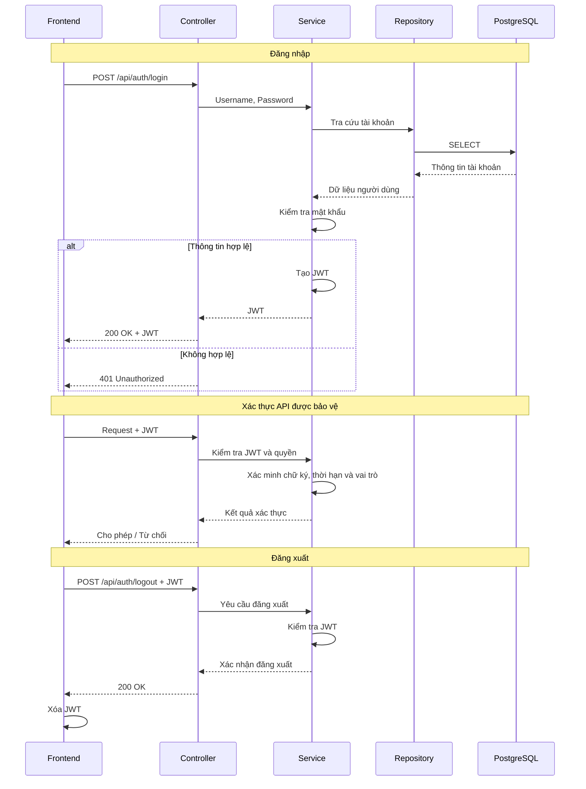
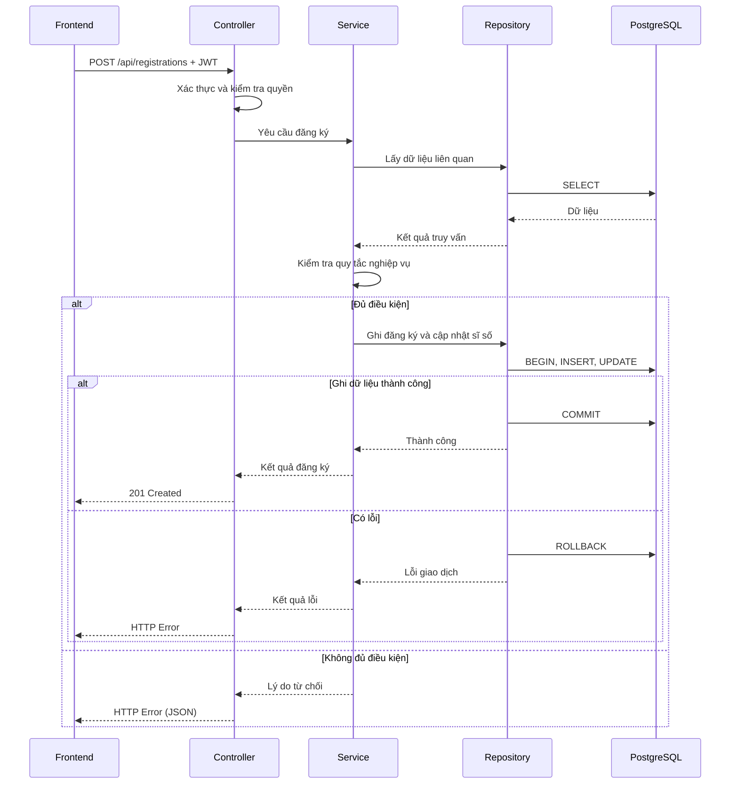

# Tài liệu kiến trúc

## 1. Giới thiệu và phạm vi kiến trúc

Hệ thống quản lý và đăng ký học phần được xây dựng dưới dạng RESTful API Backend bằng Go, tổ chức theo kiến trúc phân tầng Controller → Service → Repository. Hệ thống sử dụng PostgreSQL để lưu trữ dữ liệu, JWT để xác thực và phân quyền, JSON để trao đổi dữ liệu và OpenAPI/Swagger để tài liệu hóa API.

Phase 1 tập trung hoàn thiện các chức năng theo SRS, bảo đảm tính đúng đắn nghiệp vụ, tính nhất quán dữ liệu và bảo mật cơ bản. Tối ưu hiệu năng, mở rộng hệ thống và xử lý đồng thời chuyên sâu thuộc phạm vi Phase 2.

## 2. Cấu trúc repository

Repository được tổ chức theo từng thành phần nhằm phân tách mã nguồn Backend, Frontend, cơ sở dữ liệu và tài liệu dự án.

```text
course-registration/
├── backend/
│   ├── cmd/
│   │   └── api/
│   │       └── main.go
│   ├── internal/
│   │   ├── controller/
│   │   ├── service/
│   │   ├── repository/
│   │   └── config/
│   ├── Dockerfile
│   ├── go.mod
│   └── go.sum
├── frontend/                           # TODO: bổ sung sau
├── database/
│   └── migrations/
├── docs/
│   ├── SRS.md
│   └── database-design.md
├── docker-compose.yml
├── ARCHITECTURE.md
├── .gitignore
└── README.md
```

## 3. Luồng xử lý chính

### 3.1. Xác thực người dùng



Đối với các API được bảo vệ, Backend kiểm tra chữ ký, thời hạn JWT và quyền truy cập trước khi thực hiện nghiệp vụ.
Khi đăng xuất, Frontend gọi `POST /api/auth/logout` và xóa JWT đang lưu sau khi nhận phản hồi thành công từ Backend.

### 3.2. Đăng ký và hủy học phần



Service kiểm tra thời gian đăng ký, sĩ số, đăng ký trùng, trùng lịch, điều kiện tiên quyết và giới hạn tín chỉ.

Luồng hủy đăng ký thực hiện tương tự: kiểm tra quyền sở hữu và điều kiện hủy, sau đó cập nhật trạng thái đăng ký và sĩ số trong cùng transaction. Giao dịch được rollback nếu xảy ra lỗi.

### 3.3. Tra cứu và quản trị

- **Tra cứu:** Controller tiếp nhận yêu cầu, Service xử lý điều kiện tra cứu, Repository truy vấn dữ liệu và trả kết quả về Frontend.
- **Quản lý thông tin sinh viên:** Kiểm tra quyền truy cập và phạm vi dữ liệu trước khi xem hoặc cập nhật thông tin.
- **Quản trị lớp học phần:** Kiểm tra quyền quản trị, dữ liệu đầu vào và các ràng buộc trước khi tạo, cập nhật hoặc xóa/hủy lớp.
- **Cấu hình thời gian đăng ký:** Kiểm tra quyền quản trị và tính hợp lệ của thời gian trước khi lưu cấu hình.

## 4. Kiến trúc dữ liệu

- **Tổng quan dữ liệu**: Hệ thống sử dụng PostgreSQL để lưu trữ dữ liệu người dùng, sinh viên, học phần, lớp học phần, lịch học, kết quả học tập và đăng ký học phần. Cấu trúc bảng và các quan hệ dữ liệu được mô tả chi tiết trong `database-design.md`.

- **Truy cập dữ liệu**: Tầng Repository chịu trách nhiệm thực hiện các thao tác truy vấn và cập nhật dữ liệu trên PostgreSQL. Tầng Service xử lý logic nghiệp vụ và tương tác với cơ sở dữ liệu thông qua Repository, không thực hiện truy vấn SQL trực tiếp.

- **Giao dịch và tính nhất quán**: Các thao tác đăng ký và hủy học phần sử dụng database transaction để bảo đảm tính nhất quán giữa bản ghi đăng ký và sĩ số lớp học phần. Giao dịch được commit khi toàn bộ thao tác thành công và rollback nếu xảy ra lỗi.

## 5. Xác thực và phân quyền

- **Xác thực:** Hệ thống sử dụng JWT chứa định danh người dùng (`sub`), vai trò (`role`) và thời gian hết hạn (`exp`).
- **Kiểm tra token:** Backend xác minh chữ ký và thời hạn JWT trước khi cho phép truy cập các API được bảo vệ.
- **Phân quyền:** Quyền truy cập được kiểm tra theo vai trò Sinh viên/Quản trị viên và phạm vi dữ liệu được phép thao tác.
- **Đăng xuất:** Frontend gọi API đăng xuất và xóa JWT đang lưu. Backend không quản lý danh sách token thu hồi.
- **Bảo mật:** Mật khẩu được băm trước khi lưu trữ; JWT secret được quản lý qua biến môi trường và không lưu trực tiếp trong mã nguồn.

## 6. Kiến trúc triển khai và cấu hình

- **Đóng gói:** Frontend (React/Vite), Backend (Go/Gin) và PostgreSQL được tổ chức thành các container riêng biệt, quản lý bằng Docker Compose.
- **Cấu hình:** Backend sử dụng biến môi trường để quản lý kết nối PostgreSQL, JWT secret và cổng ứng dụng; không hardcode thông tin nhạy cảm.
- **Lưu trữ:** PostgreSQL sử dụng Docker volume để duy trì dữ liệu khi container khởi động lại.
- **Triển khai:** Môi trường phát triển có thể sử dụng HTTP; môi trường triển khai thực tế phải sử dụng HTTPS.
- **Khởi chạy:** Hệ thống được khởi chạy theo hướng dẫn trong `README.md`.