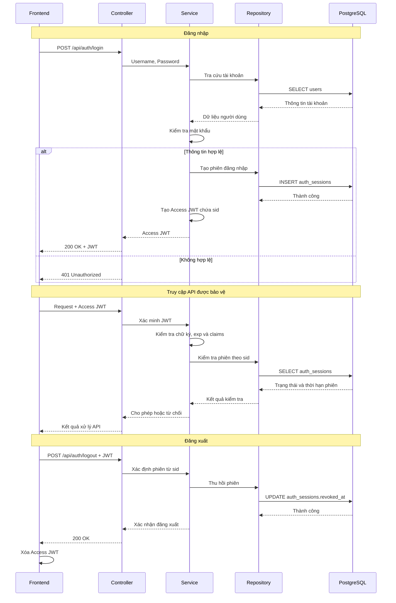
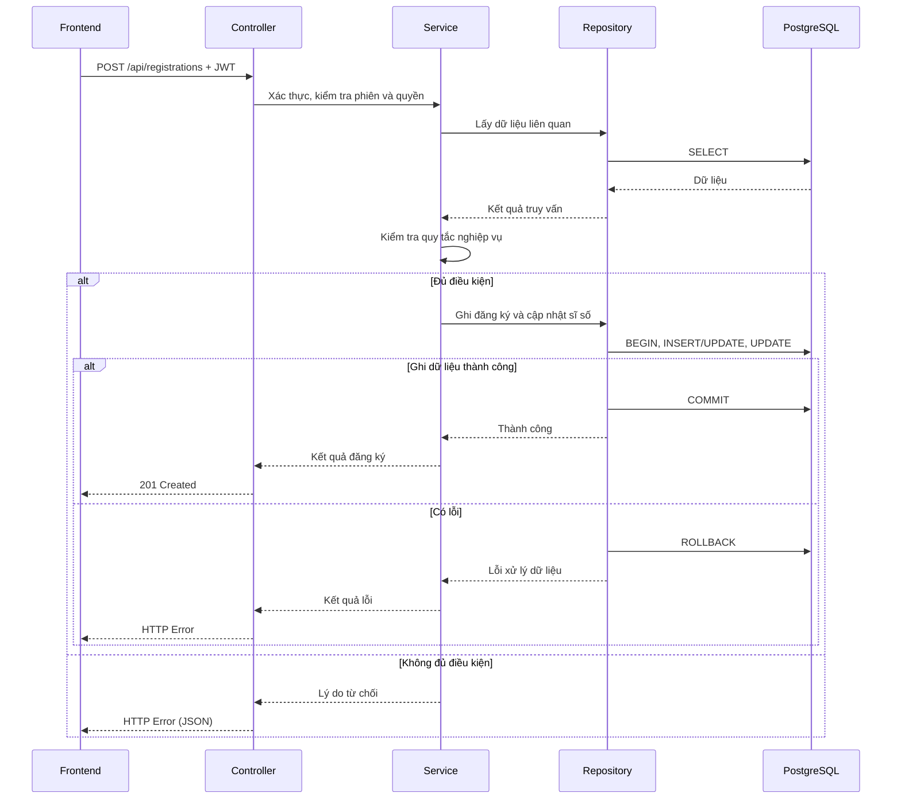

# Tài liệu kiến trúc

## 1. Giới thiệu và phạm vi kiến trúc

Phase 1 tập trung hoàn thiện các chức năng theo SRS, bảo đảm tính đúng đắn nghiệp vụ, tính nhất quán dữ liệu và bảo mật cơ bản. Tối ưu hiệu năng, mở rộng hệ thống và xử lý đồng thời chuyên sâu thuộc phạm vi Phase 2.

## 2. Cấu trúc repository

Repository được tổ chức theo từng thành phần nhằm phân tách mã nguồn Backend, Frontend, cơ sở dữ liệu và tài liệu dự án.

```text
course-registration/
├── backend/
│   ├── cmd/
│   │   └── api/
│   │       └── main.go          # nạp config, tạo DB pool, lắp ghép các tầng, chạy server
│   ├── internal/
│   │   ├── config/              # đọc biến môi trường vào struct Config
│   │   ├── controller/          # HTTP: route, middleware xác thực/phân quyền, handler, DTO, ánh xạ lỗi
│   │   ├── service/             # quy tắc nghiệp vụ, JWT, băm mật khẩu, lỗi nghiệp vụ
│   │   └── repository/          # truy vấn PostgreSQL, tạo connection pool
│   ├── docs/                    # Swagger sinh bởi swag, không sửa tay
│   ├── Dockerfile
│   ├── go.mod
│   └── go.sum
├── frontend/                    # TODO: bổ sung sau
├── database/
│   ├── migrations/
│   └── tools/
├── docs/
│   ├── SRS.md
│   ├── api-design.md
│   └── database-design.md
├── docker-compose.yml
├── ARCHITECTURE.md
├── .gitignore
└── README.md
```

### 2.1. Quy ước tổ chức code backend

- **Một file cho mỗi tài nguyên trong mỗi tầng.** Ví dụ `class.go` xuất hiện trong `controller/`, `service/` và `repository/`. Không tách thêm `dto/` hay `model/`.
- **Phụ thuộc chỉ đi một chiều:** `controller → service → repository`. Controller không chứa SQL. Service không import `gin`.
- **Struct request và response** nằm trong `controller/`. **Struct theo bảng** nằm trong `repository/` và được service dùng chung.
- **Lỗi nghiệp vụ** là biến khai báo trong `service/errors.go`, ví dụ `ErrClassFull`. Controller ánh xạ sang mã HTTP và mã lỗi theo `docs/api-design.md`.
- **JWT và băm mật khẩu** nằm trong `service/auth.go`. Middleware trong `controller/middleware.go` gọi service để xác minh token và kiểm tra phiên.
- **Repository trả `nil` khi không tìm thấy bản ghi.** Khi vi phạm ràng buộc UNIQUE, repository trả `ErrDuplicate` để service chuyển thành lỗi nghiệp vụ.
- **Route nằm trong `controller/router.go`**, gắn middleware theo nhóm endpoint.
- **Tài liệu Swagger** viết bằng chú thích ngay trên hàm handler trong `controller/`. Không duplicate nội dung API ở markdown.

## 3. Luồng xử lý chính

### 3.1. Xác thực người dùng



Access JWT chứa `sub`, `role`, `sid` và `exp`. Frontend giữ JWT trong bộ nhớ và gửi trong header `Authorization: Bearer <token>`.

Backend kiểm tra chữ ký, `exp`, và phiên tương ứng với `sid` trong `auth_sessions`: phiên phải tồn tại, chưa bị thu hồi và chưa hết hạn. Đăng xuất đặt `revoked_at`, nên JWT cũ bị từ chối ngay cả khi chưa hết hạn. Thời hạn JWT không vượt quá thời hạn phiên.

Phase 1 không có refresh token. Khi JWT hết hạn, người dùng đăng nhập lại.

### 3.2. Đăng ký và hủy học phần



Service kiểm tra thời gian đăng ký, sĩ số, đăng ký trùng, trùng lịch, điều kiện tiên quyết và giới hạn tín chỉ. Thứ tự kiểm tra và câu lệnh cập nhật sĩ số nằm trong `docs/api-design.md` mục 4.

Luồng hủy đăng ký thực hiện tương tự: kiểm tra quyền sở hữu và điều kiện hủy, sau đó cập nhật trạng thái đăng ký và sĩ số trong cùng transaction. Nếu có lỗi xảy ra, các thay đổi sẽ không được ghi nhận. Khi đăng ký lại một lớp đã hủy, hệ thống cập nhật bản ghi đăng ký cũ thay vì tạo bản ghi trùng.

### 3.3. Tra cứu và quản trị

- **Tra cứu:** Controller tiếp nhận yêu cầu, Service xử lý điều kiện tra cứu, Repository truy vấn dữ liệu và trả kết quả về Frontend.
- **Quản lý thông tin sinh viên:** Kiểm tra quyền truy cập và phạm vi dữ liệu trước khi xem hoặc cập nhật thông tin.
- **Quản trị lớp học phần:** Kiểm tra quyền quản trị, dữ liệu đầu vào và các ràng buộc trước khi tạo, cập nhật hoặc hủy lớp.
- **Cấu hình thời gian đăng ký:** Kiểm tra quyền quản trị và tính hợp lệ của thời gian trước khi lưu cấu hình.

## 4. Kiến trúc dữ liệu

- **Tổng quan dữ liệu:** Hệ thống sử dụng PostgreSQL với 9 bảng để lưu trữ người dùng, học kỳ, học phần, điều kiện tiên quyết, lớp học phần, lịch học, đăng ký học phần, phiên đăng nhập và kết quả học tập. Cấu trúc bảng và các quan hệ được mô tả chi tiết trong `database-design.md`.
- **Truy cập dữ liệu:** Tầng Repository chịu trách nhiệm truy vấn và cập nhật PostgreSQL. Tầng Service xử lý logic nghiệp vụ và truy cập dữ liệu thông qua Repository, không thực hiện truy vấn SQL trực tiếp.
- **Giao dịch và tính nhất quán:** Đăng ký và hủy học phần sử dụng database transaction để cập nhật đồng bộ bản ghi đăng ký và sĩ số lớp học phần. Các thay đổi chỉ được ghi nhận khi toàn bộ thao tác thành công.
- **Dữ liệu xác thực:** Bảng `auth_sessions` lưu thời hạn và trạng thái thu hồi của phiên đăng nhập; không lưu Access JWT. Cột `refresh_token_hash` được giữ theo schema hiện tại và chưa dùng trong Phase 1.

## 5. Xác thực và phân quyền

- **Access Token:** JWT có thời hạn ngắn, chứa định danh người dùng (`sub`), vai trò (`role`), mã phiên (`sid`) và thời điểm hết hạn (`exp`).
- **Phiên đăng nhập:** Mỗi lần đăng nhập tạo một bản ghi trong `auth_sessions`. `sid` trỏ tới bản ghi này.
- **Kiểm tra token:** Backend xác minh chữ ký, `exp` và trạng thái phiên (chưa thu hồi, chưa hết hạn) trước khi cho phép truy cập các API được bảo vệ.
- **Phân quyền:** Quyền truy cập được kiểm tra theo vai trò Sinh viên/Quản trị viên và phạm vi dữ liệu được phép thao tác.
- **Đăng xuất:** Backend đặt `revoked_at` cho phiên hiện tại. JWT của phiên đó không còn được chấp nhận. Frontend xóa JWT đang lưu.
- **Bảo mật:** Mật khẩu được băm trước khi lưu trữ. JWT secret và thời hạn token được quản lý qua biến môi trường. Token gửi qua header `Authorization`, không dùng cookie, nên Phase 1 không cần cơ chế chống CSRF riêng.

## 6. Kiến trúc triển khai và cấu hình

- **Đóng gói:** Frontend (React/Vite), Backend (Go/Gin) và PostgreSQL được tổ chức thành các container riêng biệt, quản lý bằng Docker Compose.
- **Cấu hình:** Backend sử dụng biến môi trường để quản lý kết nối PostgreSQL, JWT secret, thời hạn JWT, thời hạn phiên và cổng ứng dụng; không hardcode thông tin nhạy cảm.
- **Lưu trữ:** PostgreSQL sử dụng Docker volume để duy trì dữ liệu khi container khởi động lại, bao gồm các phiên đăng nhập.
- **Triển khai:** Môi trường phát triển có thể sử dụng HTTP; môi trường triển khai thực tế phải sử dụng HTTPS.
- **Khởi chạy:** Hệ thống được khởi chạy theo hướng dẫn trong `README.md`.
