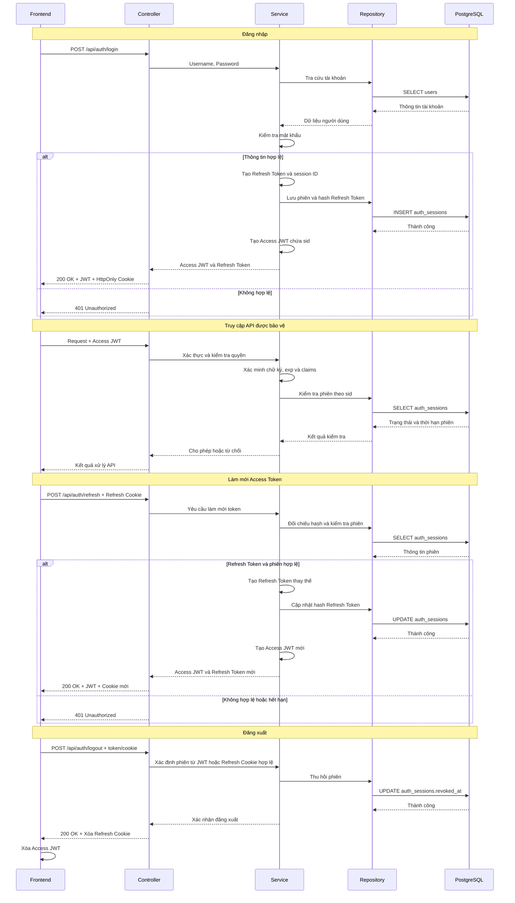
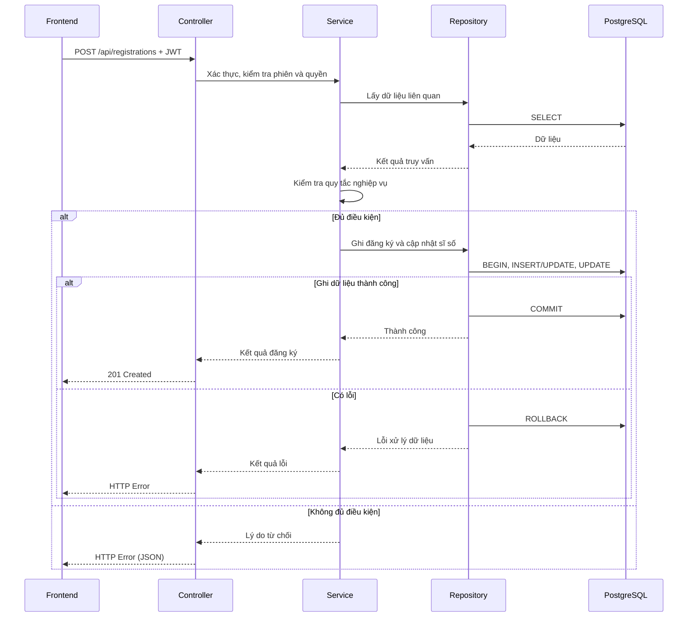

# Tài liệu kiến trúc

## 1. Giới thiệu và phạm vi kiến trúc

Phase 1 tập trung hoàn thiện các chức năng theo SRS, bảo đảm tính đúng đắn nghiệp vụ, tính nhất quán dữ liệu và bảo mật cơ bản. Tối ưu hiệu năng, mở rộng hệ thống và xử lý đồng thời chuyên sâu thuộc phạm vi Phase 2.

## 2. Cấu trúc repository

Repository được tổ chức theo từng thành phần nhằm phân tách mã nguồn Backend, Frontend, cơ sở dữ liệu và tài liệu dự án.

```text
course-registration/
├── backend/
│   ├── cmd/
│   │   └── api/
│   │       └── main.go
│   ├── internal/
│   │   ├── controller/
│   │   ├── service/
│   │   ├── repository/
│   │   └── config/
│   ├── Dockerfile
│   ├── go.mod
│   └── go.sum
├── frontend/                           # TODO: bổ sung sau
├── database/
│   └── migrations/
├── docs/
│   ├── SRS.md
│   └── database-design.md
├── docker-compose.yml
├── ARCHITECTURE.md
├── .gitignore
└── README.md
```

## 3. Luồng xử lý chính

### 3.1. Xác thực người dùng



Access JWT chứa `sub`, `role`, `sid` và `exp`; Refresh Token là chuỗi ngẫu nhiên và chỉ lưu dưới dạng hash trong `auth_sessions`. Frontend giữ Access JWT trong bộ nhớ và gửi khi gọi API; Refresh Token được lưu trong HttpOnly Cookie để làm mới JWT khi cần.

Backend kiểm tra chữ ký, thời hạn JWT, quyền truy cập và trạng thái phiên tương ứng trong PostgreSQL. Khi đăng xuất, phiên bị thu hồi nên Access JWT cũ không còn được chấp nhận, kể cả khi chưa hết hạn. Việc làm mới token phải kiểm tra phiên còn hiệu lực và luân chuyển Refresh Token.

### 3.2. Đăng ký và hủy học phần



Service kiểm tra thời gian đăng ký, sĩ số, đăng ký trùng, trùng lịch, điều kiện tiên quyết và giới hạn tín chỉ.

Luồng hủy đăng ký thực hiện tương tự: kiểm tra quyền sở hữu và điều kiện hủy, sau đó cập nhật trạng thái đăng ký và sĩ số trong cùng transaction. Nếu có lỗi xảy ra, các thay đổi sẽ không được ghi nhận. Khi đăng ký lại một lớp đã hủy, hệ thống cập nhật bản ghi đăng ký cũ thay vì tạo bản ghi trùng.

### 3.3. Tra cứu và quản trị

- **Tra cứu:** Controller tiếp nhận yêu cầu, Service xử lý điều kiện tra cứu, Repository truy vấn dữ liệu và trả kết quả về Frontend.
- **Quản lý thông tin sinh viên:** Kiểm tra quyền truy cập và phạm vi dữ liệu trước khi xem hoặc cập nhật thông tin.
- **Quản trị lớp học phần:** Kiểm tra quyền quản trị, dữ liệu đầu vào và các ràng buộc trước khi tạo, cập nhật hoặc xóa/hủy lớp.
- **Cấu hình thời gian đăng ký:** Kiểm tra quyền quản trị và tính hợp lệ của thời gian trước khi lưu cấu hình.

## 4. Kiến trúc dữ liệu

- **Tổng quan dữ liệu:** Hệ thống sử dụng PostgreSQL với 9 bảng để lưu trữ người dùng, học kỳ, học phần, điều kiện tiên quyết, lớp học phần, lịch học, đăng ký học phần, phiên đăng nhập và kết quả học tập. Cấu trúc bảng và các quan hệ được mô tả chi tiết trong `database-design.md`.
- **Truy cập dữ liệu:** Tầng Repository chịu trách nhiệm truy vấn và cập nhật PostgreSQL. Tầng Service xử lý logic nghiệp vụ và truy cập dữ liệu thông qua Repository, không thực hiện truy vấn SQL trực tiếp.
- **Giao dịch và tính nhất quán:** Đăng ký và hủy học phần sử dụng database transaction để cập nhật đồng bộ bản ghi đăng ký và sĩ số lớp học phần. Các thay đổi chỉ được ghi nhận khi toàn bộ thao tác thành công.
- **Dữ liệu xác thực:** Bảng `auth_sessions` lưu trạng thái phiên và hash Refresh Token; không lưu Access JWT. Phiên hết hạn hoặc đã bị thu hồi không được sử dụng để truy cập API hoặc làm mới token.

## 5. Xác thực và phân quyền

- **Access Token:** Sử dụng JWT có thời hạn ngắn, chứa định danh người dùng (`sub`), vai trò (`role`), mã phiên (`sid`) và thời điểm hết hạn (`exp`).
- **Refresh Token:** Là chuỗi ngẫu nhiên, được lưu phía Frontend bằng HttpOnly Cookie. Backend chỉ lưu hash của token trong `auth_sessions` và luân chuyển token khi làm mới Access JWT.
- **Kiểm tra token:** Backend xác minh chữ ký, thời hạn Access JWT và kiểm tra `sid` với phiên chưa hết hạn, chưa bị thu hồi trong PostgreSQL trước khi cho phép truy cập các API được bảo vệ.
- **Phân quyền:** Quyền truy cập được kiểm tra theo vai trò Sinh viên/Quản trị viên và phạm vi dữ liệu được phép thao tác.
- **Đăng xuất:** Backend xác định phiên qua Access JWT còn hiệu lực hoặc Refresh Cookie hợp lệ, sau đó thu hồi phiên trong `auth_sessions`. Frontend xóa Access JWT và Backend yêu cầu xóa Refresh Cookie. JWT thuộc phiên đã thu hồi không thể tiếp tục sử dụng.
- **Bảo mật:** Mật khẩu được băm trước khi lưu trữ; JWT secret và thời hạn token được quản lý qua biến môi trường. Refresh Cookie sử dụng `HttpOnly`, `Secure` khi triển khai qua HTTPS và cấu hình `SameSite` phù hợp; các API sử dụng Cookie cần được bảo vệ trước CSRF.

## 6. Kiến trúc triển khai và cấu hình

- **Đóng gói:** Frontend (React/Vite), Backend (Go/Gin) và PostgreSQL được tổ chức thành các container riêng biệt, quản lý bằng Docker Compose.
- **Cấu hình:** Backend sử dụng biến môi trường để quản lý kết nối PostgreSQL, JWT secret, thời hạn Access/Refresh Token và cổng ứng dụng; không hardcode thông tin nhạy cảm.
- **Lưu trữ:** PostgreSQL sử dụng Docker volume để duy trì dữ liệu khi container khởi động lại, bao gồm các phiên đăng nhập.
- **Triển khai:** Môi trường phát triển có thể sử dụng HTTP; môi trường triển khai thực tế phải sử dụng HTTPS.
- **Khởi chạy:** Hệ thống được khởi chạy theo hướng dẫn trong `README.md`.
