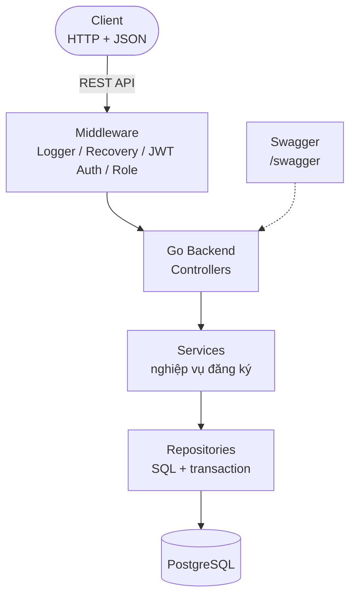
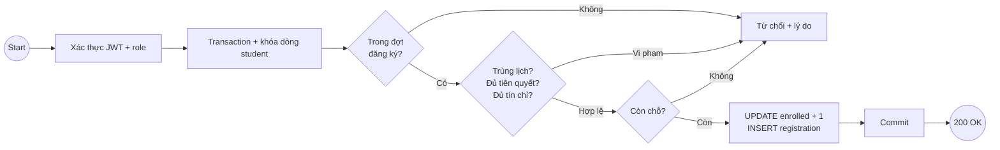

# Sơ đồ kiến trúc

## Tổng quan hệ thống

## Luồng đăng ký

## Chi tiết thành phần

| Thành phần | Công nghệ | Mục đích |
|-----------|-----------|---------|
| Client | HTTP/JSON | Gọi API, gửi JWT trong header |
| Backend | Go (Gin — đề xuất) | REST API server, phân tầng Controller/Service/Repository |
| Auth | JWT + middleware | Xác thực và phân quyền student/admin tập trung |
| Database | PostgreSQL | Lưu trữ, transaction, row-lock chống vượt sĩ số |
| API Docs | OpenAPI/Swagger | Mô tả endpoint tại `/swagger` |
| Migration | golang-migrate (đề xuất) | Quản lý schema trong `database/migrations/` |
| Deploy | Docker + docker-compose | Chạy app + database bằng một lệnh |
