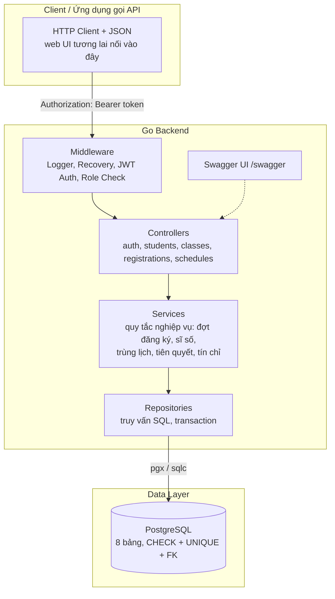
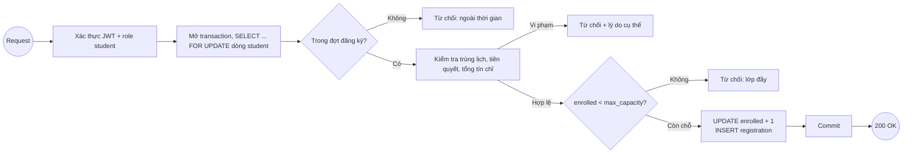
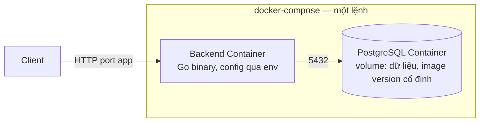

# Tài liệu kiến trúc

## Tổng quan hệ thống

Hệ thống đăng ký học phần là RESTful API backend viết bằng Go, phân tầng theo SRS 7.1: Controller (HTTP) → Service (nghiệp vụ) → Repository (truy vấn). Toàn bộ dữ liệu nằm trên PostgreSQL; tính toàn vẹn của bài toán giành chỗ (không vượt sĩ số) được bảo vệ bằng transaction và UPDATE có điều kiện ở tầng database. Xác thực dùng JWT, áp dụng tập trung qua middleware; API trả JSON với mã lỗi nhất quán và được mô tả bằng OpenAPI/Swagger.

## Sơ đồ kiến trúc

Controller không chứa quy tắc nghiệp vụ hay SQL; service không đụng HTTP; repository là nơi duy nhất viết SQL — đúng ràng buộc phân tầng của SRS 7.1.

## Các thành phần

### 1. Client

- **Mục đích:** Gọi REST API qua HTTP/HTTPS, gửi JWT trong header `Authorization` cho các endpoint được bảo vệ.
- **Tính năng chính:** Đăng nhập lấy token; tra cứu lớp đang mở; đăng ký/hủy học phần; xem thời khóa biểu.
- **Ghi chú:** SRS phạm vi ở backend API. Folder `frontend/` trong repo để dành web UI về sau — khi có, UI là một client như mọi client khác.

### 2. Backend (Go)

- **Mục đích:** Cung cấp RESTful API, thực thi nghiệp vụ đăng ký, truy cập PostgreSQL.
- **Thiết kế API:** RESTful, JSON; nhóm endpoint theo SRS 5.2: `/api/auth/*`, `/api/students/{id}`, `/api/classes`, `/api/registrations`, `/api/schedules`.
- **Xác thực:** JWT (HS256) cấp khi đăng nhập, chứa `sub` (users.id) và `role` (`student`/`admin`); kiểm tra bằng middleware ở route group, không lặp trong từng controller.
- **Phân quyền:** Hai mức — quyền chức năng (role) và quyền phạm vi dữ liệu (sinh viên chỉ thấy đăng ký của mình; admin thao tác cho sinh viên đích qua luồng quản trị).
- **Framework web:** Chưa chốt — đề xuất Gin (ADR-01 để ngỏ mục này); router thay được vì controller tách khỏi HTTP qua service.

### 3. Luồng đăng ký (Registration Flow) — nghiệp vụ trọng tâm

Toàn bộ kiểm tra chạy bên trong một transaction; hai request đồng thời của cùng sinh viên được tuần tự hóa bằng khóa dòng sinh viên, và "còn một chỗ + N request" chỉ cho đúng một request thành công (tiêu chí nghiệm thu 6, cơ chế ADR-02).

### 4. Cơ sở dữ liệu (PostgreSQL)

- **Loại:** PostgreSQL (ADR-02) — transaction, row-level locking, MVCC.
- **Bảng (8):** `users`, `semesters`, `courses`, `course_prerequisites`, `course_results`, `course_classes`, `class_schedules`, `registrations` — chi tiết và ràng buộc xem [database-design.md](database-design.md), ERD xem [database.dbml](database.dbml).
- **Migration:** Đặt trong `database/migrations/` (tính từ gốc repo), thứ tự phụ thuộc FK: users → semesters → courses → course_prerequisites → course_results → course_classes → class_schedules → registrations. Công cụ chạy migration chọn khi implement (đề xuất golang-migrate).
- **Không có Vector Store:** hệ thống không dùng LLM/RAG.

## Luồng dữ liệu

1. Client gửi request kèm JWT trong header `Authorization`.
2. Middleware xác thực token, gắn `user_id` + `role` vào context; chặn 401/403 nếu thiếu hoặc sai quyền.
3. Controller parse JSON, validate đầu vào (định dạng, trường bắt buộc), gọi service — không chứa SQL hay nghiệp vụ.
4. Service mở transaction, chạy quy tắc nghiệp vụ: cửa sổ đăng ký, trùng lịch, tiên quyết, giới hạn tín chỉ, sĩ số.
5. Repository thực thi SQL trong transaction (UPDATE có điều kiện cho sĩ số, INSERT đăng ký).
6. Service commit hoặc rollback; controller trả JSON với mã trạng thái nhất quán (200/201/400/401/403/404/409/422).

## Kiến trúc triển khai

- SRS 7.3: `Dockerfile` + `docker-compose.yml` khởi chạy ứng dụng cùng database bằng một lệnh.
- Thông tin cấu hình (DSN, JWT secret, port) đọc từ biến môi trường, không hardcode.
- Production thực tế dùng HTTPS/TLS phía trước (SRS 6.6); compose local không cần TLS.

## Bảo mật

- Mật khẩu băm bcrypt/argon2, không lưu plaintext, không log dữ liệu nhạy cảm (SRS 6.5).
- JWT gửi qua header `Authorization: Bearer <token>`; token chứa định danh + vai trò, hết hạn có thời hạn.
- Authentication + authorization qua middleware tập trung ở route group; controller không tự kiểm token (SRS 6.7, 7.2).
- Phân quyền kiểm tra cả chức năng (role) lẫn phạm vi dữ liệu (quyền sở hữu đăng ký).
- Validate mọi đầu vào; secret đặt trong `.env` (đã gitignore), không commit.
- CSRF không áp dụng cho API thuần token-based; CORS cấu hình khi có web UI.

## Quyết định thiết kế

| Quyết định | Lựa chọn | Lý do |
| --- | --- | --- |
| Ngôn ngữ | Go | ADR-01: goroutine cho tải đột biến, deploy 1 binary, type tĩnh |
| Database | PostgreSQL | ADR-02: UPDATE có điều kiện + row lock chống vượt sĩ số |
| Kiến trúc | 3 tầng Controller/Service/Repository | SRS 7.1 — tách HTTP khỏi nghiệp vụ khỏi SQL |
| Auth | JWT | Stateless, phù hợp scale ngang (SRS 6.1); quyết định của nhóm |
| Web framework | Gin (đề xuất) | Chưa chốt — quyết định khi implement, ADR-01 để ngỏ |
| DB access | pgx + sqlc (đề xuất) | Chưa chốt — quyết định khi implement |
| Load test | Trên Kaggle CPU | SRS 6.4 — báo cáo latency/throughput/concurrency/tỷ lệ lỗi |
