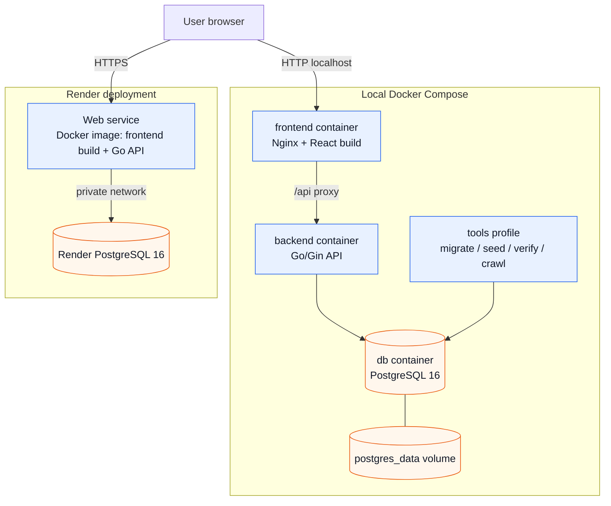

# Deployment Diagram

Sơ đồ triển khai hệ thống mô tả cấu trúc triển khai trên 2 môi trường:
1. **Local Development (Docker Compose)**: gồm frontend container (Nginx + React build), backend container (Go/Gin), PostgreSQL 16 container, tools container (migrate/seed/verify/crawl), và postgres_data volume.
2. **Render Cloud Deployment**: gồm Web Service container (Single Docker image đóng gói cả Frontend build và Go API binary) kết nối qua private network tới Render PostgreSQL 16.

## Trực quan hóa

## Định dạng có sẵn

- [Mermaid source](deployment.mmd) (`deployment.mmd`)
- [PlantUML source](deployment.puml) (`deployment.puml`)
