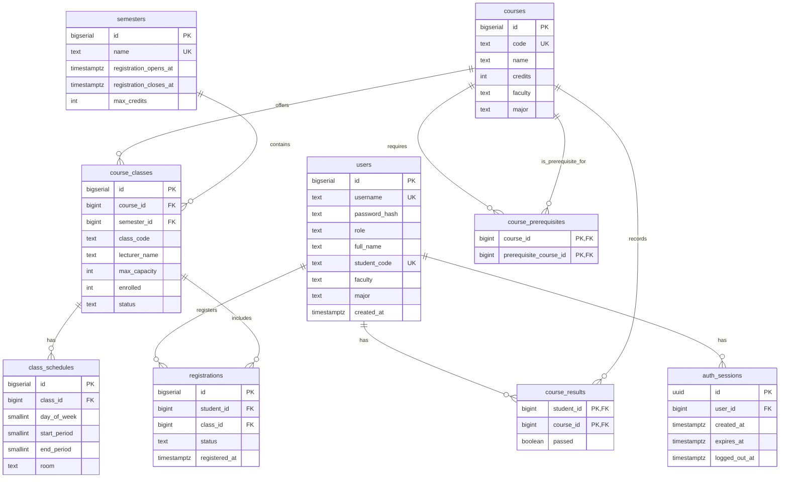

# Entity Relationship Diagram (ERD)

Sơ đồ quan hệ thực thể mô tả cấu trúc 9 bảng của cơ sở dữ liệu PostgreSQL cho Hệ thống Đăng ký Học phần: `users`, `semesters`, `courses`, `course_prerequisites`, `course_classes`, `class_schedules`, `registrations`, `auth_sessions`, `course_results`.

## Trực quan hóa

## Định dạng có sẵn

- [Mermaid source](erd.mmd) (`erd.mmd`) - Dùng cho GitHub preview và Markdown docs
- [DBML source](database.dbml) (`database.dbml`) - Dùng cho [dbdiagram.io](https://dbdiagram.io)
- [PlantUML source](erd.puml) (`erd.puml`) - Dùng cho PlantUML tools
