# System Architecture Diagram

Sơ đồ kiến trúc tổng thể của hệ thống thể hiện cấu trúc phân tầng (Frontend React, Nginx proxy, Backend Go/Gin 3 tầng: Controller - Service - Repository, và PostgreSQL 16).

## Trực quan hóa

```mermaid
flowchart LR
    browser[Browser]
    frontend[Frontend\nReact + TypeScript + Vite]
    nginx[Frontend Nginx\nlocal Compose only]
    api[Backend API\nGo + Gin]
    controller[Controller layer\nHTTP routes, middleware, DTOs]
    service[Service layer\nbusiness rules, JWT, password hashing]
    repository[Repository layer\nSQL and transactions]
    postgres[(PostgreSQL)]
    swagger[Swagger / OpenAPI]

    browser -->|HTTP/HTTPS JSON| frontend
    frontend -->|same-origin /api| nginx
    nginx -->|proxy /api in local development| api
    browser -->|same-origin API in Render| api

    api --> controller
    controller --> service
    service --> repository
    repository --> postgres
    api --> swagger

    classDef client fill:#e8f1ff,stroke:#2563eb,color:#111827
    classDef backend fill:#eafaf1,stroke:#16a34a,color:#111827
    classDef data fill:#fff7ed,stroke:#ea580c,color:#111827
    class browser,frontend,nginx client
    class api,controller,service,repository,swagger backend
    class postgres data
```

## Định dạng có sẵn

- [Mermaid source](system-architecture.mmd) (`system-architecture.mmd`)
- [PlantUML source](system-architecture.puml) (`system-architecture.puml`)
