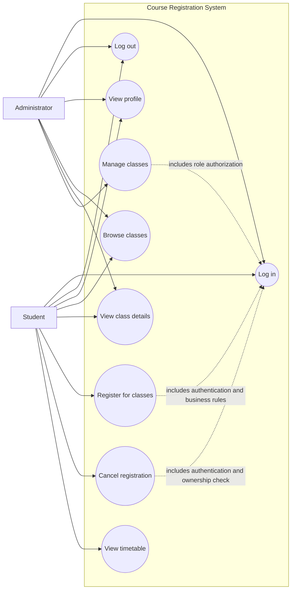

# Use Case Diagram

Sơ đồ ca sử dụng của Hệ thống Đăng ký Học phần mô tả tương tác giữa 2 tác nhân chính (Sinh viên và Quản trị viên) với các chức năng nghiệp vụ tương ứng 12 endpoint API.

## Trực quan hóa

## Định dạng có sẵn

- [Mermaid source](use-case.mmd) (`use-case.mmd`)
- [PlantUML source](use-case.puml) (`use-case.puml`)
